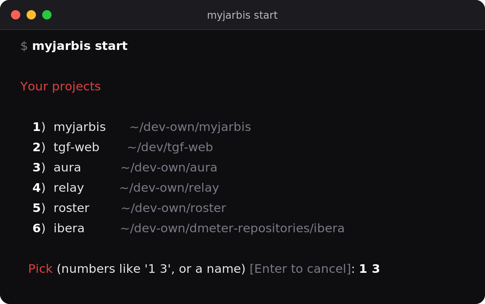
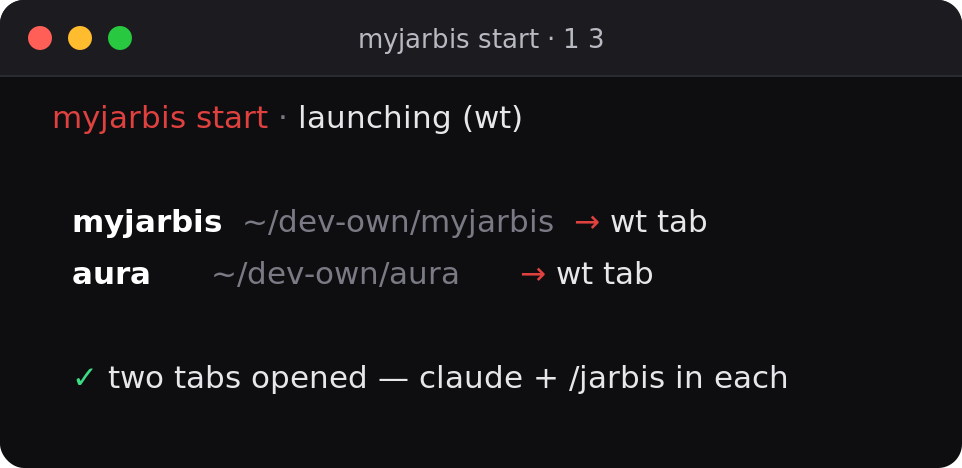
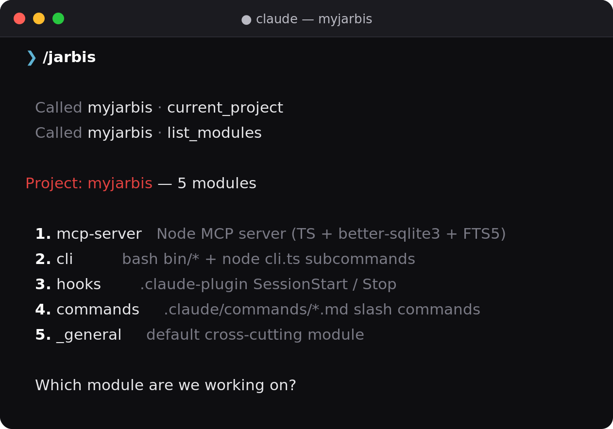
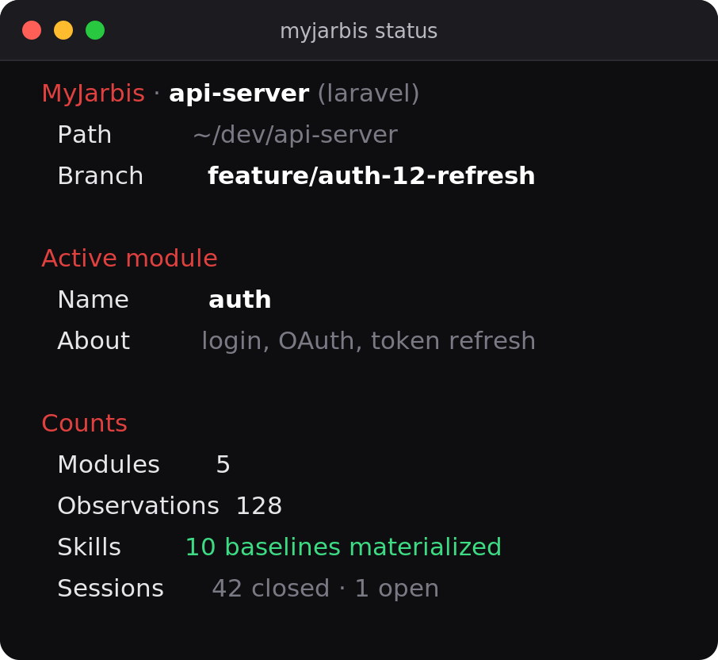
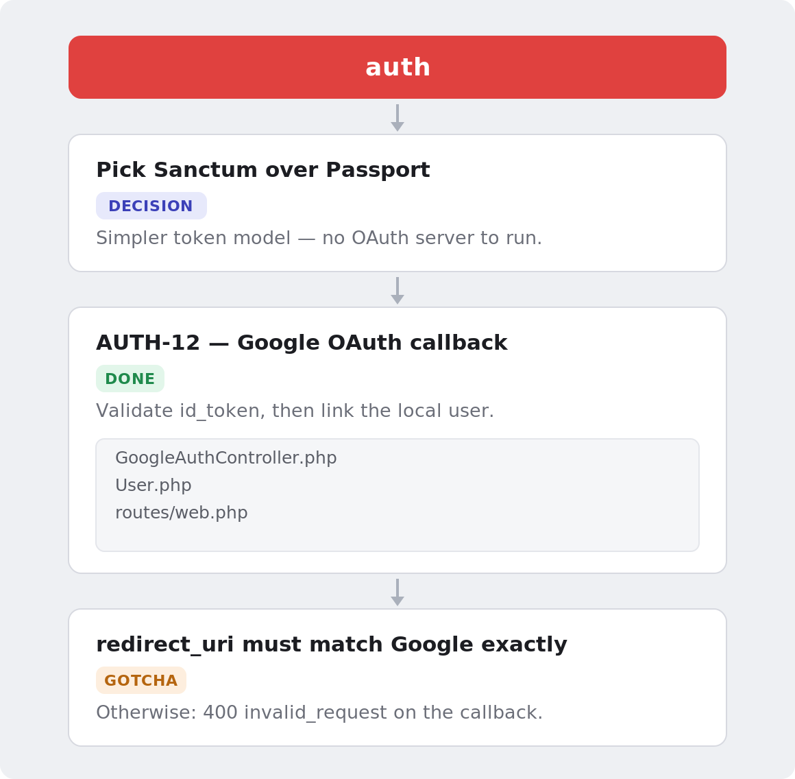

<h1 align="center">MyJarbis</h1>

<p align="center">
  <b>Persistent memory + per-project workflow + scoped skills for Claude Code.</b><br>
  Three slash commands: open, save, close. Everything else is a conversation.
</p>

<p align="center">
  
</p>

<p align="center">
  <i>Run <code>myjarbis start</code> from anywhere → pick a project → it opens a terminal already running Claude + <code>/jarbis</code>.</i>
</p>

---

## In plain terms

AI coding assistants forget everything when you close them. Every morning
you re-explain the same things: how this project is built, the rules the
team follows, what you were in the middle of yesterday.

MyJarbis is the notebook the assistant never had. It remembers:

- **the decisions** — what you chose and *why*, so nobody re-opens it later
- **the traps** — the thing that broke once, so it doesn't break twice
- **where you stopped** — so tomorrow starts with "here's where you were",
  not a blank page
- **how your team works** — the review rules, the release checklist, the
  order things get done in

It also *enforces* that last one. If the team's process says "someone else
approves before this merges", the assistant stops and asks instead of
deciding on its own.

Everything is stored on your own machine, in a plain database file. Nothing
is uploaded anywhere.

<sub>The rest of this page is for developers.</sub>

---

## What it is

Claude Code has no project memory. You repeat conventions, re-explain
architecture, and lose "what was I doing yesterday."

**MyJarbis is a persistent-memory layer over MCP (Model Context
Protocol).** It turns Claude Code into a project-aware orchestrator that
remembers what you decided, where you left off, and which workflow
applies to each part of the project — without dumping everything into
context every session.

Every read/write goes through standard MCP tools + a local SQLite DB, so
**any MCP-compatible client** (Cursor, OpenClaw, future agents) can sit
on the same memory.

MyJarbis is installed *on top of* Claude Code, and `/jarbis` is an
explicit override, not a suggestion: what the project says outranks the
agent's defaults, and a workflow gate is a stop rather than a hint.
It does **not** override safety — no workflow authorises deleting
without a backup or skipping a confirmation you'd want.

---

## Where to go

| If you want to… | Read |
|---|---|
| understand the idea in 60 seconds | [In plain terms](#in-plain-terms) |
| install it and run it today | [Start in 30 seconds](#start-in-30-seconds) |
| see what using it actually looks like | [See it work](#see-it-work) |
| know what each feature does | [The features](#the-features) — one line each, expand what matters |
| wire it into a team | [Org packs](#the-features) and [Workflows as data](#the-features) |
| understand how it is built | [Deep dive](#deep-dive) |
| upgrade an existing install | [`docs/UPGRADING.md`](docs/UPGRADING.md) |

Everything below the fold is collapsed on purpose. Open only what you need —
nothing has been cut.

---

## Start in 30 seconds

```bash
# 1. install (once)
git clone https://github.com/braiantroncoso/myjarbis.git
cd myjarbis && ./install.sh

# 2. register a project (once per project)
cd ~/projects/my-app
myjarbis init

# 3. work — from anywhere, any day
myjarbis start
```

`myjarbis start` lists your projects, you pick one (or several), and it
opens a fresh terminal already `cd`'d in, with `claude` running and
`/jarbis` fired. No more `cd` → `claude` → `/jarbis` by hand.

<p align="center">
  
</p>

Prefer the classic way? It still works:

```bash
cd ~/projects/my-app
claude
> /jarbis
```

---

## See it work

`/jarbis` boots a session: it loads the project, lists your modules
(verticals), and resumes exactly where you left off.

<p align="center">
  
</p>

After that, **everything is natural language** — the agent knows which
MCP tool to call:

| You say…                                          | Agent does                                       |
|----------------------------------------------------|--------------------------------------------------|
| "let's work on AUTH-12"                            | search story + audit acceptance criteria + propose a phase |
| "I decided to use Laravel Sanctum"                 | `save_observation(kind=decision)`                |
| "heads up, refresh tokens must revoke access"      | `save_observation(kind=gotcha)`                  |
| "mark AUTH-12 done with commit abc"                | `update_progress` (row-level state)              |
| "commit this"                                      | git commit with a WHY / FOR-WHAT body, no signature |
| "let's switch to frontend"                         | confirm + `end_session` + `start_session(frontend)` |
| "open backend and frontend together"               | one session on backend (primary), frontend read-only |
| "where was I?"                                     | `resume()` — reads back the "Resume here"        |
| "done, close it"                                   | summary + `next_session` + `end_session`         |

The next `/jarbis` resumes right where this one ended.

The CLI is consistent and instant (zero LLM tokens) — here's `myjarbis status`:

<p align="center">
  
</p>

---

## The features

One line each. Expand the ones you care about; skip the rest.

| | What it gives you |
|---|---|
| **Per-project, per-module** | memory scoped to the vertical you are in — open one, or several with one primary |
| **`myjarbis start`** | launch any project from anywhere, with Claude and `/jarbis` already running |
| **CLI workflow** | git-like verbs that cost zero LLM tokens |
| **Org packs** | load how your team works instead of teaching it to each project |
| **Workflows as data** | process as rows with inheritance, addressed by capability, not vendor |
| **Notes with identity** | saving again updates a note instead of leaving a rival next to it |
| **One brain or many** | shared by default, isolated when a project needs it |
| **Living diagrams** | documentation that redraws itself from what you saved |

<details>
<summary><b>Why per-project, per-module?</b></summary>

In real projects, work is **vertical**. You don't work on "the codebase";
you work on the Checkout flow, then Catalog, then Translations. Each
vertical has its own workflow, plan, stories, and skills.

MyJarbis models that explicitly — and **only loads the vertical you're in**:

```
org (optional — owns the pack: skills, workflows, taxonomy)
 └ project
  ├── project_context (practices, deps, conventions — always loaded)
  ├── project_state   (new in v0.3 — the living "resume here", one row not N notes)
  ├── providers       (new in v0.3 — which tracker / forge / ci this project uses)
  ├── workflows       (new in v0.3 — process as rows, org to project to user)
  ├── modules (verticals — you create them)
  │     ├── module_context (workflow, plan, stories, AC)
  │     │     └── progress  (per-row state, like a "Smoke/Commit" column)
  │     ├── sessions (start → save observations → end, closed automatically)
  │     │     └── observations (decisions, gotchas, progress)
  │     │           ├── topic_key (new in v0.3 — identity; saving again updates it)
  │     │           └── refs      (new in v0.3 — links to commits / MRs / tickets)
  │     └── skills (module-level — only when this module is active)
  └── skills (project-level — always loaded: 10 baselines + any org pack)
```

When you open Claude, the SessionStart hook asks which vertical you want.
**Only that module + the project core get loaded.** The other modules stay
out of context — that's the core token-saving move.

You can open **several at once** when a job spans them (`myjarbis module use
cli,server`). The first is the **primary**: it owns the session, the notes
and the handoff. The rest come along read-only, as an index — a row count
and when they were last touched, never their bodies — so the token-saving
move survives having them open. Details in
[CLI workflow](#the-features).

</details>

<details>
<summary><b><code>myjarbis start</code> — launch from anywhere</b></summary>

Run it from **any** directory. It reads your global registry, lets you
pick by number, name, or substring, and opens each chosen project ready
to work.

```bash
myjarbis start                 # interactive picker
myjarbis start api-server     # by name (or substring) — skip the picker
myjarbis start                 # then type "1 3" to launch two at once
```

It **auto-detects** how to open each project (override with a flag):

| Environment             | Opens as                          | Force     |
|-------------------------|-----------------------------------|-----------|
| WSL + Windows Terminal  | a new `wt.exe` tab per project    | `--wt`    |
| inside a `tmux` session | a new tmux window per project     | `--tmux`  |
| otherwise               | replaces the current shell (one)  | `--here`  |

```bash
myjarbis start --print         # dry-run: print the resolved command(s), launch nothing
myjarbis start --no-jarbis     # open claude without firing /jarbis
myjarbis start --cmd "/resume" # custom initial prompt instead of /jarbis
myjarbis start --json          # list registered projects as JSON and exit
```

Projects whose path no longer exists are flagged `(path missing)` and
skipped. On WSL the tab is forced opaque (`--opacity 100`) so it doesn't
inherit a transparent profile. After you exit claude, the tab drops to a
shell in the project dir (keep-alive), so the window stays useful.

</details>

<details>
<summary><b>CLI workflow (git-like)</b></summary>

`/jarbis` is fastest when it doesn't have to render a menu — it just
continues with what's set. The CLI handles setup and switching, like
`git checkout`, all instant and token-free:

```bash
myjarbis module use backend       # set active module (like git checkout)
myjarbis module use cli,server    # open several — the FIRST one is primary
myjarbis module current           # print the open set, primary marked
myjarbis module unset             # clear → next /jarbis shows the menu

myjarbis status                   # git-like overview (project, module, counts)
myjarbis config list              # language, persona, scope, nudges
myjarbis config persona mentor    # change how the agent talks back
```

With an active module set, opening `claude` auto-resumes it and prints
the curated "Resume here" — `/jarbis` then only acknowledges and
continues (no tool calls, no menu render).

**More than one module at a time.** Work rarely respects module
boundaries: touching the CLI usually means reading what the server does,
and a module the session cannot see is a module whose decisions get
re-made. Name several and the first is the **primary** — the session
belongs to it, and so do observations, progress and the handoff. The
rest come along **read-only**: their context is searchable and their
last activity is shown, but nothing is written to them. One session, one
handoff, no migration.

If you'd rather pick inside Claude, say so and `/jarbis` offers the
modules as checkboxes, with the last-used one pre-selected as primary.
Either way the choice is remembered for the next session.

> `search` is an **MCP tool**, not a CLI verb — the agent calls it; there
> is no `myjarbis search`. Use `myjarbis status` and `myjarbis timeline`
> from the shell.

</details>

<details>
<summary><b>Org packs — load how your team works, don't teach it</b></summary>

`myjarbis init` seeds ten generic skills. Everything specific to *your
organization* — review rules, release checklist, how tickets get closed —
used to be taught to each project by hand, which means it reliably wasn't.

An **org pack** is a directory you keep in your own (private) repo:

```
<pack>/
├── pack.yml            slug, name, compatible_with
├── skills/*.md         skills to add
├── overrides/*.md      skills that REPLACE a baseline of the same name
├── context-kinds.yml   extra taxonomy labels
├── workflows/*.yml     workflows at org scope
└── providers.yml       tracker / forge / ci templates — never credentials
```

```bash
myjarbis org add acme ~/work/acme-pack     # register + apply here
myjarbis init --org=acme                   # new project, pack included
myjarbis org sync acme                     # re-apply to EVERY project of the org
myjarbis org diff acme                     # what sync would change (dry run)
```

<p align="center">
  
</p>

Applying is idempotent (`created | updated | unchanged` per item) and ends
by writing skills to `.claude/skills/` — the database alone configures
nothing the agent can see. A project whose brain predates v0.3 is reported
as skipped rather than silently missed.

**MyJarbis ships no pack.** `examples/pack/` holds a fictional one so the
contract is readable. Your rules, client names and tool wrappers stay out
of this repo.

</details>

<details>
<summary><b>Workflows as data, not prose</b></summary>

Process written as prose gets duplicated and then contradicted. Workflows
are rows, resolved **org → project → user** into one ordered list:

```bash
myjarbis workflow show ticket-close
```

<p align="center">
  
</p>

A step names an **abstract capability** (`tracker.comment`), never a
product. Which tool that means comes from the project's provider row — so
one org workflow serves a client on one tracker and a client on another,
and MyJarbis never learns a vendor's name.

`gate=approve` means *stop and ask*. Conditions are decidable
(`branch ~= release/*`, `framework in [laravel, express]`), not free text
for the agent to interpret differently each session.

```bash
myjarbis provider set tracker acme-tracker --config='{"base_url":"https://..."}'
```

> Never put a credential in `--config`. It's rejected on write *and* on
> export, because the brain dump is meant to be committed. Store the
> location instead: `{"token_file": "~/.config/acme/token"}`.

</details>

<details>
<summary><b>Notes that have identity</b></summary>

Three habits formed in v0.2 because nothing better existed. v0.3 gives
each one a column:

| The habit | What replaces it |
|---|---|
| A new note titled *"CORRECTS note 80"* | `topic_key` — saving again **updates** that note |
| *"Do not repeat: comments 4-29337–41"* in prose | `find_by_ref` — a boolean, not a paragraph |
| A new *"RESUME HERE"* note every session | `project_state` — one row, with an expiring lock |

```bash
myjarbis state get          # the living state
myjarbis kinds list         # the allowed context kinds
```

`kind` is a catalogue now, not free text — three projects once invented
three vocabularies for the same seven ideas. An unknown kind is rejected
*with the nearest match*; a pack can add its own.

</details>

<details>
<summary><b>One brain or many</b></summary>

Pre-v0.3 there was one `memory.db` per project. That still works and is
still the default (`isolation = silo`). v0.3 adds a **shared brain** at
`~/.myjarbis/memory.db` so a cross-cutting change is one action.

The isolation that the filesystem used to provide is now enforced in code,
and it is not optional:

- scope is bound to the **connection**, not passed per query
- a read with no scope **fails** rather than returning every project
- passing another project's id is **refused**, not honoured
- crossing projects needs an explicit scope **and a stated reason**

`tests/v03-isolation.sh` asserts all four. Migration is opt-in and backs
up first:

```bash
myjarbis migrate --dry-run              # report, touch nothing
myjarbis migrate                        # upgrade this project's brain
myjarbis merge --from <proj>/.myjarbis/memory.db --as acme-portal
```

Opening a brain never migrates it — merely *looking* for a project would
otherwise rewrite the schema of files you never named.

</details>

---

<details>
<summary><b>What's new in v0.3</b></summary>

v0.2 gave the memory a schema. v0.3 is about what the memory was
*still* doing in prose — and the three habits that proves.

| The habit that formed | Why it formed | v0.3 |
|---|---|---|
| A new note titled *"CORRECTS note 80"* | nothing could say "this replaces that" | `topic_key` — saving again **updates** the note |
| *"Don't repeat: comments 4-29337–41"* written into a paragraph | the brain was being used as an idempotency ledger with no structure to be one | `find_by_ref` — a boolean, not a re-read |
| A fresh *"RESUME HERE"* note every session | the current state had no home | `project_state` — one row, with an expiring lock |

Plus the four structural ones:

- **Org packs** — load how your team works instead of teaching it to each
  project. `overrides/` replaces a baseline skill; `org sync` re-applies
  to every project in one command.
- **Workflows as data** — process as rows with org → project → user
  inheritance, addressed by abstract capability (`tracker.comment`), so
  the core never learns a vendor's name.
- **A fixed taxonomy** — `kind` comes from a catalogue. Three real
  projects had invented three vocabularies for the same seven ideas.
- **Sessions that close themselves** — `summary` was NULL on 2 of 2
  sessions in one real project. Now the harness closes them, in two
  places, so it survives a killed terminal.

Everything is additive. Existing projects keep working on their current
schema until you run `myjarbis migrate`, which backs up first.
[Full details above](#the-features).

</details>

---

## Deep dive

<details>
<summary><b>Bootstrap a project (init, modules, importing your .md files)</b></summary>

```bash
cd ~/projects/my-app
myjarbis init                          # creates memory.db + 10 baselines + plugin hooks
```

`myjarbis init` is **interactive** — it asks two questions to personalize
how Claude talks back:

```
Languages: EN (United States), ES (Argentina), PT (Brazil)
  Language [EN/es/pt]: en

Personas:
  1=Concise (token-saving) — terse, no preamble (default)
  2=Pair programmer — 1-line intent before each change
  3=Mentor — WHAT/WHY/HOW/BENEFITS
  4=Critical reviewer — challenges your assumptions first
  Persona [1/2/3/4, default 1]: 1
```

Skip the prompts for CI / scripts:

```bash
MYJARBIS_LANGUAGE=ES MYJARBIS_PERSONA=concise myjarbis init
```

Create your verticals and import the `.md` files you already keep on disk:

```bash
myjarbis module add backend
myjarbis module add frontend

myjarbis import agents/WORKFLOW.md         --target=project        --kind=workflow
myjarbis import agents/backend/PLAN.md     --target=module:backend --kind=plan
myjarbis import agents/backend/tickets.json --target=module:backend --kind=story --mapping='stories[]'
```

Re-imports are **idempotent** (SHA-256 on content): unchanged → no-op,
changed → in-place UPDATE.

</details>

<details>
<summary><b>The daily flow + the SessionStart menu</b></summary>

```bash
cd ~/projects/my-app
claude
> /jarbis
```

The SessionStart hook fires:

```
═══ MyJarbis · my-app (laravel) ═══

Modules:
  • backend, last session 2026-05-04 14:30 UTC
  • frontend (paused)

Pick a module to begin (e.g., "let's work on backend").
Or create a new one: `myjarbis module add <name>`.

── Last "Retomar aquí" (backend, 2026-05-04 14:30 UTC) ──
PR #1234 merged to develop. Next: start AUTH-12 with the JWT
refresh flow. Branch: feature/auth-12-refresh-jwt.
```

The menu **always shows** — even with one module — so you can switch
verticals, create one, or change settings without leaving Claude.
Timestamps are absolute ISO (not "2h ago"), so the output is byte-stable
and Anthropic's prompt cache survives between calls.

You say *"let's work on backend"* → the agent calls
`start_session("backend")` and gets project_core + backend context + the
previous `next_session`. Only the 10 baselines + backend's module-level
skills are materialized to `.claude/skills/`. Frontend's are not on disk.

Name two and you get both: *"backend and frontend"* →
`start_session("backend", with_modules=["frontend"])`. Backend is the
primary and frontend rides along read-only, so the banner reads
`Module: backend (primary)` with the companions listed underneath.

</details>

<details>
<summary><b>Per-row state — the <code>progress</code> field</b></summary>

Hand-edited PROGRESS.md tables have a "Smoke" column, a "Commit" column, a
"Status" column — **per-row state**. MyJarbis ships the same primitive:
every `module_context` row (typically a story) has a free-form markdown
`progress` field the agent maintains:

```
"mark SHOP-S3.6 as done with commit abc1234, smoke OK"
  ↓
update_progress(
  local_id = "SHOP-S3.6",
  progress = "done · batch 2 (2026-05-04) · commit abc1234 · smoke OK"
)
```

The `progress` text travels with the row in `start_session`, `search`, and
`load_module` — so the next `/jarbis` already sees which stories are done,
in progress, or blocked, without reading any MD.

| MD workflow                            | MyJarbis equivalent                          |
|----------------------------------------|----------------------------------------------|
| Edit PROGRESS.md "Smoke" column        | `update_progress(local_id, "done · ...")`    |
| Edit CURRENT.md rolling summary        | `end_session(summary, next_session)`         |
| Edit ERRORS.md new lesson              | `save_observation(kind=gotcha, ...)`         |
| Read CURRENT.md next morning           | `previousSession.nextSession` in `start_session` |

</details>

<details>
<summary><b>RAG-style context loading (how it stays cheap)</b></summary>

`start_session` does **not** dump the full module library. It returns:

- `previousSession.nextSession` — the curated "Resume here" (read first)
- `projectContext[]` / `moduleContext[]` — index entries (title + 240-char
  excerpt + `progress` flag)
- `stories: { count, entries: [{localId, progress?}] }` — inventory, no body

When the agent needs a full row, it follows the canonical RAG pattern:

```
1. search(query, scope="module")     # FTS5 snippets with row IDs
2. load_module(row_ids=[<id>])       # full body of just those rows
```

`load_module` returns **excerpts by default**; `full=true` is opt-in and
warns past 50KB — so the agent never accidentally loads 100KB+ of docs
into one call.

</details>

<details>
<summary><b>The 10 baseline skills</b></summary>

Materialized to `.claude/skills/myjarbis-<name>/SKILL.md` and loaded at
session start.

> Claude Code identifies a skill by its **directory name**, not by the
> `name:` in its frontmatter. So these appear as `myjarbis-<name>` — the
> prefix is what makes them safe to clean up without touching skills you
> wrote yourself.

| Skill                  | What it teaches the agent                                    |
|------------------------|--------------------------------------------------------------|
| `module-orchestration` | How to pick/switch modules + conversational triggers         |
| `session-protocol`     | When to close a session + summary + next_session format      |
| `observation-protocol` | When to save decision/gotcha/progress + natural triggers     |
| `story-driven`         | Pipeline detect → audit → execute → close, by phases         |
| `bitacora-progress`    | How to write a "next_session" that helps tomorrow            |
| `framework-detect`     | Auto-explore the codebase on the first session               |
| `subagent-delegation`  | When to spawn Explore/Plan/general-purpose in parallel       |
| `compact-protocol`     | Structured snapshot before native `/compact`                 |
| `interaction-style`    | Your tone / language / depth (composed at init)              |
| `commit-hygiene`       | Commit format + git log as queryable context                 |

**`commit-hygiene`** — every commit follows `type(scope): description`
with a `Por qué:` / `Para qué:` body, no `Co-Authored-By: Claude`, no
`--no-verify`, no `git add -A`. The git log becomes queryable memory.

**`interaction-style`** — composed from your language + 1 of 4 personas
(Concise / Pair programmer / Mentor / Critical reviewer). Re-edit anytime
with `myjarbis skill edit interaction-style`.

</details>

<details>
<summary><b>Custom skills (project- or module-level)</b></summary>

```bash
# project-level (always active here)
myjarbis skill add tracker-rules --content-from=docs/tracker-rules.md \
  --description="Issue-tracking rules for this project"

# module-level (only active when working on checkout)
myjarbis skill add checkout-conventions --module=checkout \
  --content-from=docs/checkout-conventions.md \
  --description="checkout: copy HTML from design package, never reinterpret"
```

When you `start_session(checkout)`, checkout's skills materialize to `.claude/skills/`.
Switch modules and they disappear; the new module's appear.

</details>

<details>
<summary><b>What the hooks do automatically</b></summary>

`init` binds 5 events, as a `hooks` block in `.claude/settings.local.json`:

- **SessionStart (startup|resume|clear)** — if `.myjarbis/active` is set,
  auto-starts that module and prints the curated `next_session` (no menu).
  Otherwise prints the localized module menu. Output is byte-stable.
  `resume` is bound too, so `claude --continue` gets a session like any other
  way of starting one. `.myjarbis/active` holds one module per line, primary
  first, so a file written by an older version still reads correctly.
- **SessionStart (compact)** — restores the pre-compact snapshot.
- **UserPromptSubmit** — first message forces ToolSearch + detects story
  localIds. Optional save reminder via `nudges.save_reminder_minutes`.
- **Stop** — reminds you to close an open session.
- **SessionEnd** — auto-closes any session still open when Claude exits.

The scripts live in `.claude-plugin/scripts/`, but copying that directory is
not what attaches them: Claude Code only reads a plugin's `hooks.json` for
plugins installed from a marketplace. `myjarbis hook install claude` writes
the binding and `init` calls it. The write merges, so your own hooks and
permissions in that file are untouched.

**Copied is not installed, and that distinction is the whole trap.** A project
can hold a byte-identical copy of every script and have all five events dead
— nothing looks wrong, because each script runs perfectly by hand. Two states,
two repairs:

| flag in `myjarbis health` | what is wrong | fix |
|---|---|---|
| `hooks stale` | the scripts differ from the template | `myjarbis update --projects-only` |
| `unwired` / `N event(s) unbound` | the scripts are fine, nothing binds them | same command, or `myjarbis hook install claude` in that project |

If MyJarbis never greets you when Claude opens, that is what to check:

```bash
myjarbis health                  # whole machine
myjarbis doctor                  # this project
myjarbis hook install claude     # fix it, then reopen Claude
```

Hooks are read at startup, so **the repair is invisible until you restart.**

**Optional git `post-commit` hook** (`myjarbis hook install git-post-commit`):
on every commit while a session is open, saves a `progress` observation
with the hash, message, files, and detected story id. Idempotent.

**Stale-resume warning** — when the "Resume here" is older than 7 days
(`session.stale_after_days`), the hook surfaces a warning to confirm the
context still applies before the agent proceeds.

</details>

<details>
<summary><b>Living diagrams — documentation that draws itself</b></summary>

Every module can get a draw.io diagram that is a *view* of its memory — you
never draw it by hand. You code, you tell MyJarbis what you did (the
`save_observation` you already do), and the diagram redraws itself.

It reads top-to-bottom as a **narrative of the work**: one card per
observation, its `kind` as the tag, the title and "why" straight from what you
saved, and the files it touched nested inside. Cards chain with arrows in the
order things happened.

<p align="center">
  
</p>

```bash
myjarbis diagram                # (re)generate + open the active module's diagram
myjarbis config diagram on      # opt in to auto-generate/open (default off)
```

It's **opt-in**: by default it only runs when you ask. Turn `diagram.auto` on
and session hooks + `save_observation` + `update_progress` keep it live and pop
it open in VS Code (install the
[Draw.io Integration](https://marketplace.visualstudio.com/items?itemName=hediet.vscode-drawio)
extension to render `.drawio` inside the editor).

</details>

<details>
<summary><b>Architecture</b></summary>

```
┌─────────────────────────────────────────────────────────────────┐
│  CLAUDE CODE (harness)                                          │
│  hooks: SessionStart · UserPromptSubmit · Stop · SessionEnd     │
│  /jarbis · /jarbis-close  ·  skills read from .claude/          │
└────────────────────────────────┬────────────────────────────────┘
                                 ▼
┌─────────────────────────────────────────────────────────────────┐
│  MCP SERVER (Node/TS, ~/.myjarbis-global/mcp-server/)           │
│  Always-loaded (20):                                            │
│    current_project · list_modules · start/end_session · resume  │
│    load_project_core · load_module · search                     │
│    save_observation · update_progress · suggest_topic_key       │
│    update_observation · find_by_ref · add_ref                   │
│    get/set_project_state · get_workflow · list_workflows        │
│  Deferred, loaded on demand (12):                               │
│    create_module · *_skills · import_* · set_interaction_style  │
│    set_workflow_step · list_context_kinds · list/set_provider   │
│    search_code · get_context · update_memory      (v0.1 aliases)│
└────────────────────────────────┬────────────────────────────────┘
                                 ▼
┌─────────────────────────────────────────────────────────────────┐
│  SCOPE — bound to the connection, not passed per query          │
│  {kind:'project', id} | {kind:'all', reason}                    │
│  A read with no scope FAILS. Another project's id is REFUSED.   │
└────────────────────────────────┬────────────────────────────────┘
                                 ▼
┌─────────────────────────────────────────────────────────────────┐
│  SQLite — better-sqlite3 + FTS5                   (schema v4)   │
│    <project>/.myjarbis/memory.db     isolation = silo (default) │
│    ~/.myjarbis/memory.db             isolation = shared         │
│                                                                 │
│  orgs → projects → project_context · modules · skills           │
│                  → project_state · providers · workflows        │
│  modules → module_context · sessions → observations → refs      │
│  context_kinds (the taxonomy)  ·  workflow_steps                │
└─────────────────────────────────────────────────────────────────┘
```

Resolution order for "which project is this?": an explicit `--project`,
then the normalised **git remote**, then the nearest enclosing registered
path — then failure. It never creates a brain; only `myjarbis init` does.

Each project has its own `memory.db`. `shared: true` commits it to the
repo (whole team loads the same context — `init --shared=true` warns that
observations may carry tokens/paths). `shared: false` (default) is
`.gitignore`d and personal.

</details>

<details>
<summary><b>Token economy + <code>myjarbis cost</code></b></summary>

Five levers keep token use low:

1. **Per-module loading** — only the active module + project core ride the
   system prompt. Opening several modules keeps this: the primary loads as
   usual, companions arrive as an index (a row count and when they were last
   worked in), never bodies.
2. **Index by default** — `start_session` / `load_module` return excerpts;
   full bodies arrive only via `load_module(row_ids=[...])` after a search.
3. **Cache-stable hooks** — byte-deterministic output so the prompt cache
   survives between turns.
4. **Deferred admin tools** — 9 of 18 MCP tools load on demand
   (~600–1200 tokens saved/session).
5. **Trilingual `/jarbis`** — each project loads only its language variant.

```bash
myjarbis cost                  # tokens + cache hit ratio per session, USD approx
myjarbis cost --last=5 --json
```

Hit ratio above ~80% means the cache is working; below ~50% means
something is emitting variable content and busting it.

</details>

<details>
<summary><b>Scoped search</b></summary>

`search` is FTS5 over project_context, module_context, skills, and
observations. Scopes:

- `module` (default) — the open modules (primary + any companions) +
  project_core. **Token-saving.** The response names which ones it
  searched; an explicit `module=` is never widened.
- `project` — every module of this project + project_core
- `module_only` — only the active or named module
- `observations` — only the session log
- `skills` — only skill content

With 5 modules indexed, the default `module` scope means the agent only
sees hits from the one you're in.

</details>

<details>
<summary><b>Migrations</b></summary>

**v0.1 → v0.2** (markdown → SQLite) runs automatically on first open:
`knowledge-base.md` → observations, `daily.md` → workflow,
`project-summary.md` → functional spec, 10 baselines seeded. Auto-backup
at `~/.myjarbis-global/backups/<project>/<ts>/`. Legacy aliases
(`search_code`, `get_context`, `update_memory`) still work.

**Schema versioning** — `MyJarbisDB.open()` walks `MIGRATIONS[v]` from
current+1 up to `SCHEMA_VERSION`; each step is idempotent. v3 added
`module_context.progress` and upgrades any v2 DB in place.

</details>

<details>
<summary><b>Full Bash CLI reference</b></summary>

```bash
myjarbis init                       # init project (interactive)
myjarbis start [name] [flags]       # global launcher (see above)
myjarbis doctor                     # health check (25+ probes)
myjarbis status [--json]            # git-like overview
myjarbis timeline <module> [--json --limit=N]
myjarbis stats                      # row counts per table
myjarbis cost [--last=N] [--json]   # token usage + cache hit ratio
myjarbis list                       # registered projects
myjarbis update [--projects] [--yes] # pull + rebuild MCP server
myjarbis update --projects-only     # only repair project hooks + wiring (no rebuild)
myjarbis hook install claude [--check]
                                    # bind the lifecycle hooks (init does this; --check only reports)
myjarbis hook install git-post-commit

myjarbis health                     # every project at once: schema, activity, what is cold
myjarbis gc [--apply]               # report (and remove) the litter previous versions left
myjarbis backfill-remotes [--apply] # record the git remote on projects predating the field

myjarbis review [--module=... --threshold=N] [--apply]
                                    # group notes that are successive versions of one topic
myjarbis skill reseed [--all] [--apply]
                                    # push improved baseline skills to projects that exist
myjarbis commands sync [--all] [--apply] [--force]
                                    # push the slash commands to projects that exist

myjarbis brain export | import | status   # the DB as tracked NDJSON

myjarbis module list | use <n>[,<n>…] | current | unset | add <n> [--description=...]
myjarbis config list | language <EN|ES|PT> | persona <concise|pair|mentor|reviewer>
myjarbis config diagram <on|off>

myjarbis skill add <name> --content-from=<file> [--module=...] [--description=...]
myjarbis skill list | edit | delete | enable | disable | materialize

myjarbis import <file.md>   --target=<project|module:NAME> --kind=<kind>
myjarbis import <file.json> --target=... --kind=<kind> --mapping='items[]'
```

</details>

<details>
<summary><b>Per-project settings (<code>.myjarbis/config/settings.json</code>)</b></summary>

```json
{
  "version": "0.2.0",
  "project": { "name": "my-app", "framework": "laravel" },
  "shared": false,
  "search_default_scope": "module",
  "story_pattern": "[A-Z]+-S?\\d+(\\.\\d+)?",
  "auto_module_select_when_single": true,
  "skills": {
    "materialize_on_session_start": true,
    "cleanup_module_skills_on_session_end": false
  },
  "nudges": { "save_reminder_minutes": null },
  "session": { "stale_after_days": 7 },
  "diagram": { "auto": false }
}
```

- `nudges.save_reminder_minutes` — positive integer N reminds the agent to
  `save_observation` after N+ idle minutes; `null` keeps hooks cache-stable.
- `diagram.auto` — opt-in living diagram. `false` = only `myjarbis diagram`
  generates/opens it; `true` = session hooks keep it live in VS Code.

</details>

<details>
<summary><b>Tests</b></summary>

```bash
bash tests/run-all.sh          # 18 suites, 302 assertions, each builds its own fixture
```

```bash
tests/bootstrap-import.sh      # 12 .md + 1 JSON bulk import idempotency
tests/skills-lifecycle.sh      # baselines + module-level + cleanup on switch
tests/full-session-cycle.sh    # open → work → close → reopen → resume
tests/compact-cycle.sh         # snapshot pre/post /compact roundtrip
tests/dx-batch-1.sh            # stale-resume + timeline + post-commit auto-observation
tests/v03-isolation.sh         # one project never reads another's rows
tests/v03-shared-resolution.sh # silo vs shared resolution, and settings surviving a bump
tests/v03-migrate-merge.sh     # row counts, foreign keys and FTS after a merge
tests/v03-org-pack.sh          # packs, overrides, workflows, providers
tests/v03-auto-close.sh        # auto-close, and the curated handoff it must not bury
tests/v03-maintenance.sh       # health, gc, backfill-remotes
tests/v04-review-reseed.sh     # what review and reseed must NOT do
tests/v04-commands-sync.sh     # a hand-edited command survives --apply
tests/v04-close-ritual.sh      # what /jarbis-close writes, read back by a fresh session
tests/v04-chat-triggers.sh     # the conversational surface, not the CLI one
tests/v04-hook-wiring.sh       # the events end up bound, and your own hooks survive it
tests/v045-session-ownership.sh # the hook's session is the one the MCP server sees
tests/v045-unwired-detection.sh # copied-but-unwired is detected, and repaired
```

House rule: a new suite is only trusted once the fix it covers has been
reverted on purpose and the assertion confirmed red.

Most of `myjarbis update` is still verified by hand on a real machine — it is a
bash installer that runs `npm install` and a build, which a suite has no
business doing. Its repair half is covered, through `--projects-only`: that
path exists precisely because fixing a project's hooks needs none of the
install machinery, which makes it both safe to run mid-session and cheap to
assert.

`run-all.sh` refuses to start if `global/bin/` exists in the checkout. That
directory is not in the repository, but one dev run of `update` pointed at the
checkout's own `global/` creates it — and `bin/myjarbis` prefers
`$MYJARBIS_INSTALL_DIR/bin`, so from then on every suite tests that frozen
snapshot instead of `bin/` and passes regardless of the source.

</details>

---

<p align="center">
  <b>Three slash commands: <code>/jarbis</code> to open, <code>/jarbis-save</code> to write it down, <code>/jarbis-close</code> to close.</b> Everything else is conversation or a quick CLI verb.<br>
  No <code>/plan</code>, <code>/implement</code>, <code>/complete</code> — the 10 baseline skills let the agent infer all of it.<br>
  None of the three is a new capability. They are the rituals worth having a key for: the <code>SessionEnd</code> hook always closes the session, but only a written handoff tells the next one what to do — and <code>/jarbis-save</code> writes that handoff without ending anything, for the sessions that stop without being closed.
</p>

<p align="center">
  MIT · Built by Braian Axel Troncoso 🇦🇷
</p>
